# Arquitetura do Execution Service

Este documento descreve o serviço por dentro: responsabilidades, camadas e módulos, o modelo de dados completo, os fluxos passo a passo, a mensageria, a segurança e as decisões. A arquitetura global da fase 4 (divisão dos serviços, saga, catálogo de mensagens, rotas e o recorte de dados de que os contratos dependem) está na [RFC-004](https://github.com/fiap-postech-sw-architecture/postech-sw-arch-p4-platform/blob/main/docs/arquitetura/rfc/fase4/rfc-004-microsservicos-saga.md) e nos [ADRs 034 a 043](https://github.com/fiap-postech-sw-architecture/postech-sw-arch-p4-platform/tree/main/docs/arquitetura) do repositório `platform`; a [seção 7](https://github.com/fiap-postech-sw-architecture/postech-sw-arch-p4-platform/blob/main/docs/arquitetura/rfc/fase4/rfc-004-microsservicos-saga.md#7-dados) da RFC remete a este arquivo o modelo com todas as colunas. O [README](../README.md) traz a operação (configuração, implantação, testes, métricas e um `curl` por endpoint), e [`docs/api/`](api) o OpenAPI e a coleção Postman.

Conferido contra o código da `main` em 18/10/2026 (commit `301052a`); onde a decisão não é óbvia, o texto aponta o arquivo.

## 1. Contexto e responsabilidades

O Execution Service é a oficina: recebe a ordem para diagnóstico, mostra a fila ao mecânico, guarda o que ele apontou, separa as peças do estoque, põe a ordem na fila de execução e dá baixa nas peças quando o reparo termina. Participa da saga de atendimento orquestrada pelo OS Service ([ADR-035](https://github.com/fiap-postech-sw-architecture/postech-sw-arch-p4-platform/blob/main/docs/arquitetura/adr/fase4/035-saga-orquestrada.md)): consome os comandos que o orquestrador manda e publica os fatos de volta, sem nunca chamar o OS Service.

| É dono de | Não é dono de |
|---|---|
| Diagnósticos (fila do mecânico, itens apontados, observações) | Status da OS e estado da saga (OS Service) |
| Execuções (fila de execução por prioridade, início e fim do reparo) | Preços de serviços e peças (Billing) |
| Estoque físico por SKU: saldo, reserva, liberação e baixa | Cadastro de clientes e veículos (OS Service): aqui fica só um retrato do veículo |

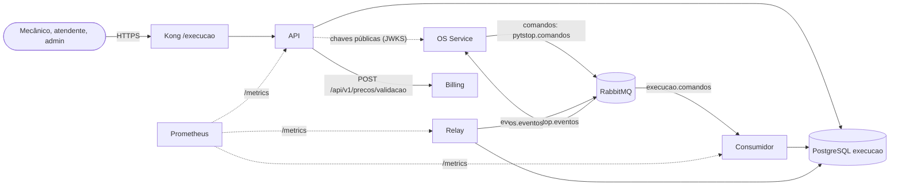

As três partes rodam a mesma imagem com comandos diferentes: a API (`uvicorn src.main:app`), o relay da outbox (`python -m src.relay`) e o consumidor dos comandos (`python -m src.consumidor`). A única chamada síncrona a outro serviço é a validação de preços no Billing, na conclusão do diagnóstico ([ADR-038](https://github.com/fiap-postech-sw-architecture/postech-sw-arch-p4-platform/blob/main/docs/arquitetura/adr/fase4/038-borda-e-comunicacao-sincrona.md)); o JWKS (JSON Web Key Set) do OS Service, o conjunto das chaves públicas que conferem a assinatura do token, é lido para validar o token, não é chamada de negócio.

## 2. Camadas e módulos

DDD com arquitetura em camadas (onion): `dominio` ← `aplicacao` ← `infraestrutura` e `interfaces`. O `import-linter` prende os contratos no `make check` ([`pyproject.toml`](../pyproject.toml), `[tool.importlinter]`): a camada de cima importa as de baixo e nunca o contrário; domínio e aplicação não importam FastAPI, Pydantic, SQLAlchemy, pika, httpx, PyJWT, jsonschema nem OpenTelemetry; `compartilhado` não conhece contexto algum; e o núcleo (domínio e aplicação) de um contexto não importa o de outro.

| Módulo | O que tem |
|---|---|
| `src/compartilhado` | Base de entidades e VOs (`Entity`, `AggregateRoot`, `ValueObject`, `Veiculo`, código do Billing), exceções, máquina de estados, unidade de trabalho com outbox, banco, JWT e JWKS, circuit breaker, logging com mascaramento, métricas, telemetria e a mensageria (relay, consumidor, contratos) |
| `src/estoque` | `ItemEstoque` (SKU como VO) e `Reserva`; serviço de domínio da reserva tudo ou nada ([`services.py`](../src/estoque/dominio/services.py)); casos de uso do cadastro e dos comandos `ReservarPecas` e `LiberarReserva` |
| `src/diagnostico` | `Diagnostico` (identidade = `ordem_id`); comandos `SolicitarDiagnostico` e `DescartarDiagnostico`; início e conclusão pela API, com a validação no Billing ([`validador_billing.py`](../src/diagnostico/infraestrutura/validador_billing.py)) |
| `src/execucao` | `Execucao` (identidade = `ordem_id`); comandos `AgendarExecucao`, `CancelarExecucao` e `AnonimizarVeiculo`; fila, início (o pivot da saga: depois dele a OS não cancela mais) e finalização com baixa pela API |
| `src/main.py`, `src/relay.py`, `src/consumidor.py` | Os três processos; o consumidor liga cada tipo de comando ao handler do contexto dono (`HANDLERS`) |
| `src/coletor.py` | As gauges calculadas na raspagem do `/metrics` da API (outbox, duração das execuções, peças em falta) |
| `src/banco.py` | `aguardar` (initContainer que espera a migração da imagem) e `restringir` (o Job tira da aplicação a escrita na `alembic_version`) |
| `src/mapeamentos.py` | Importa os mapeamentos imperativos do SQLAlchemy de todos os contextos |

Cada contexto segue o mesmo corte: `dominio` (agregados, VOs, regras, porta do repositório), `aplicacao` (casos de uso, eventos de integração, portas para fora do contexto), `infraestrutura` (mapeamento imperativo, repositórios e adapters) e `interfaces` (rotas HTTP, schemas Pydantic e os handlers dos comandos). O domínio é feito de dataclasses puras; a tabela é declarada na infraestrutura.

A conversa entre contextos passa por portas na aplicação e adapters na infraestrutura, sem import entre os núcleos:

| Quem pergunta | Porta ([`execucao/aplicacao/ports.py`](../src/execucao/aplicacao/ports.py), [`diagnostico/aplicacao/ports.py`](../src/diagnostico/aplicacao/ports.py)) | Quem responde |
|---|---|---|
| Execução | `EstoquePort`: a ordem tem reserva ativa? consome a reserva na baixa | estoque (`EstoqueSQLAlchemyAdapter`) |
| Execução | `VeiculosPort`: o retrato do veículo da ordem, copiado no agendamento | diagnóstico (`VeiculosSQLAlchemy`) |
| Execução | `DiagnosticosDoVeiculoPort` e `MensagensGuardadasPort`: o que a eliminação de dados pessoais da LGPD (Lei Geral de Proteção de Dados) troca | diagnóstico e outbox |
| Diagnóstico | `CatalogoDePecasPort`: as peças apontadas existem e estão ativas no estoque? | estoque (`CatalogoDePecasSQLAlchemy`) |
| Diagnóstico | `ValidadorDeItensPort`: os códigos têm preço? | Billing, por HTTP |

## 3. Modelo de dados

PostgreSQL 16, banco `execucao`, só deste serviço ([ADR-037](https://github.com/fiap-postech-sw-architecture/postech-sw-arch-p4-platform/blob/main/docs/arquitetura/adr/fase4/037-banco-por-servico.md)). O esquema vem das migrações do Alembic ([`001_esquema_inicial.py`](../migrations/versions/001_esquema_inicial.py) e [`002_mensageria.py`](../migrations/versions/002_mensageria.py)), e os mapeamentos imperativos declaram as mesmas tabelas ([`estoque`](../src/estoque/infraestrutura/mapping.py), [`diagnostico`](../src/diagnostico/infraestrutura/mapping.py), [`execucao`](../src/execucao/infraestrutura/mapping.py), [`outbox_mapping.py`](../src/compartilhado/infraestrutura/outbox_mapping.py)); os testes de integração criam o banco pelas migrações, não pelos mapeamentos. Datas sempre com fuso (`timestamptz`, UTC). Além das seis tabelas abaixo há a `alembic_version`, do Alembic. Nos comentários das colunas, **lápide** é o registro que uma compensação grava quando chega antes do comando original, já no estado final ([seção 4.4](#44-compensações-e-lápide)).

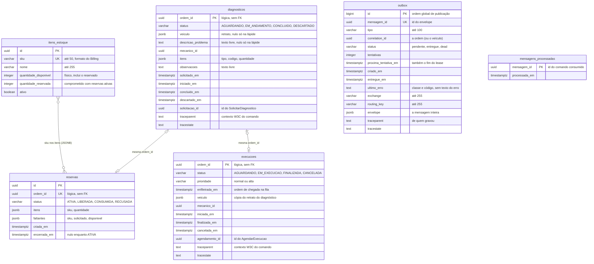

As relações entre `diagnosticos`, `reservas` e `execucoes` são lógicas: `ordem_id` é a identidade da ordem de serviço do OS Service, sem chave estrangeira (o dado de outro serviço nunca é chave local), e é única em cada tabela (a chave primária do diagnóstico e da execução, uma `UNIQUE` na reserva). É isso que torna cada comando idempotente por ordem e sustenta a lápide ([seção 4.4](#44-compensações-e-lápide)).

O ER da RFC-004 (seção 7.3) traz `traceparent` e `tracestate` como `varchar`; as colunas são `text`, como nas migrações. No PostgreSQL, sem tamanho declarado, os dois tipos se guardam e se comportam do mesmo jeito.

### 3.1 Estoque: `itens_estoque` e `reservas`

| Coluna | Tipo | Nulo | Regra |
|---|---|---|---|
| `itens_estoque.id` | `uuid` | não | chave primária |
| `itens_estoque.sku` | `varchar(50)` | não | `UNIQUE` (`uq_itens_estoque_sku`); o código de peça do Billing: letras maiúsculas e dígitos separados por hífens ([`codigo.py`](../src/compartilhado/dominio/codigo.py)) |
| `itens_estoque.nome` | `varchar(255)` | não | |
| `itens_estoque.quantidade_disponivel` | `integer` | não | saldo físico, inclui o reservado; `CHECK >= 0` (`ck_itens_estoque_disponivel_nao_negativa`) |
| `itens_estoque.quantidade_reservada` | `integer` | não | `CHECK 0 <= reservada <= disponivel` (`ck_itens_estoque_reservada_dentro_do_disponivel`), o invariante do agregado repetido no banco |
| `itens_estoque.ativo` | `boolean` | não | a desativação (`DELETE`) é lógica: a peça sai de novos diagnósticos e reservas |
| `reservas.id` | `uuid` | não | chave primária; o `reserva_id` do `PecasReservadas` |
| `reservas.ordem_id` | `uuid` | não | `UNIQUE` (`uq_reservas_ordem_id`): uma reserva por ordem |
| `reservas.status` | `varchar(20)` | não | `CHECK` com os quatro estados (`ck_reservas_status`) |
| `reservas.itens` | `jsonb` | não | `[{"sku", "quantidade"}]`, vazio na lápide |
| `reservas.faltantes` | `jsonb` | não | `[{"sku", "solicitado", "disponivel"}]`, só na `RECUSADA`: a resposta repetida sai daqui, sem decidir de novo |
| `reservas.criada_em` | `timestamptz` | não | |
| `reservas.encerrada_em` | `timestamptz` | sim | preenchida na recusa, na liberação, na baixa e na lápide |

A quantidade livre (`quantidade_disponivel - quantidade_reservada`) não é coluna: é calculada no agregado ([`item_estoque.py`](../src/estoque/dominio/item_estoque.py)) e é o `disponivel` dos faltantes. Ao contrário do p3, reservar não consome o saldo: a reserva soma em `quantidade_reservada`, a liberação subtrai de volta e a baixa subtrai das duas colunas.

### 3.2 Diagnóstico: `diagnosticos`

| Coluna | Tipo | Nulo | Regra |
|---|---|---|---|
| `ordem_id` | `uuid` | não | chave primária e identidade do agregado |
| `status` | `varchar(20)` | não | `CHECK` com os quatro estados (`ck_diagnosticos_status`) |
| `veiculo` | `jsonb` | sim | retrato do `SolicitarDiagnostico`: `{"veiculo_id", "placa", "marca", "modelo", "ano"}`; nulo só na lápide |
| `descricao_problema` | `text` | sim | texto livre do atendente; nulo só na lápide |
| `mecanico_id` | `uuid` | sim | o `sub` do token de quem iniciou |
| `itens` | `jsonb` | não | `[{"tipo": "servico" ou "peca", "codigo", "quantidade"}]`, vazio até a conclusão |
| `observacoes` | `text` | não | texto livre do mecânico, vazio até a conclusão |
| `solicitado_em`, `iniciado_em`, `concluido_em`, `descartado_em` | `timestamptz` | só `solicitado_em` não | uma por transição |
| `solicitacao_id` | `uuid` | sim | `id` do comando que abriu o fluxo: o `causation_id` dos fatos que o mecânico gera; nulo na lápide |
| `traceparent`, `tracestate` | `text` | sim | contexto de trace do comando, fora do agregado: o passo do mecânico roda como filho dele ([`rastreamento.py`](../src/compartilhado/infraestrutura/rastreamento.py)) |

Índices: `ix_diagnosticos_status_solicitado_em` (`status`, `solicitado_em`), a fila do mecânico em ordem de chegada, e `ix_diagnosticos_veiculo_id` (`veiculo ->> 'veiculo_id'`), para a eliminação LGPD achar os retratos sem varrer a tabela.

### 3.3 Execução: `execucoes`

| Coluna | Tipo | Nulo | Regra |
|---|---|---|---|
| `ordem_id` | `uuid` | não | chave primária e identidade do agregado |
| `status` | `varchar(20)` | não | `CHECK` com os quatro estados (`ck_execucoes_status`) |
| `prioridade` | `varchar(10)` | não | `CHECK IN ('normal', 'alta')` (`ck_execucoes_prioridade`), o enum do contrato `AgendarExecucao` |
| `enfileirada_em` | `timestamptz` | não | desempate da fila dentro da mesma prioridade |
| `veiculo` | `jsonb` | sim | cópia do retrato do diagnóstico, para a fila mostrar o carro; nula na lápide e quando a ordem não tem retrato no diagnóstico (`VeiculosPort.da_ordem` devolve `None`, [`ports.py`](../src/execucao/aplicacao/ports.py)) |
| `mecanico_id` | `uuid` | sim | quem iniciou; o admin age em nome dele sem trocá-lo |
| `iniciada_em`, `finalizada_em`, `cancelada_em` | `timestamptz` | sim | uma por transição |
| `agendamento_id` | `uuid` | sim | `id` do `AgendarExecucao`: o `causation_id` do início e da finalização; nulo na lápide |
| `traceparent`, `tracestate` | `text` | sim | como no diagnóstico |

Índices: `ix_execucoes_status` (a fila e a posição filtram `AGUARDANDO`) e `ix_execucoes_veiculo_id` (`veiculo ->> 'veiculo_id'`).

### 3.4 Mensageria: `outbox` e `mensagens_processadas`

| Coluna | Tipo | Nulo | Regra |
|---|---|---|---|
| `outbox.id` | `bigint` (sequência) | não | chave primária; a ordem de publicação |
| `outbox.mensagem_id` | `uuid` | não | `UNIQUE` (`uq_outbox_mensagem_id`); o `id` do envelope |
| `outbox.tipo`, `outbox.correlation_id` | `varchar(100)`, `uuid` | não | repetem o envelope para índice, métrica e ordem por saga |
| `outbox.status` | `varchar(20)` | não | `pendente` (padrão), `entregue` ou `dead` |
| `outbox.tentativas` | `integer` | não | padrão 0; a quinta falha de publicação vira `dead` |
| `outbox.proxima_tentativa_em` | `timestamptz` | não | padrão `now()`; quando a linha volta a ser elegível e, durante a publicação, o fim do lease, que serve de token: o relay só grava o desfecho se o lease ainda for o dele |
| `outbox.criado_em` | `timestamptz` | não | padrão `now()` |
| `outbox.entregue_em` | `timestamptz` | sim | hora da confirmação do broker |
| `outbox.ultimo_erro` | `text` | sim | só a classe do erro ou o código do broker |
| `outbox.exchange`, `outbox.routing_key` | `varchar(255)` | não | `pytstop.eventos` e `evento.execucao.<tipo em snake_case>` |
| `outbox.envelope` | `jsonb` | não | a mensagem inteira, validada contra o JSON Schema do contrato na gravação |
| `outbox.traceparent`, `outbox.tracestate` | `text` | sim | contexto de quem gravou: o `publish` sai como filho dele |
| `mensagens_processadas.mensagem_id` | `uuid` | não | chave primária; o `id` de cada comando consumido |
| `mensagens_processadas.processada_em` | `timestamptz` | não | padrão `now()`; o consumidor apaga as linhas com mais de 30 dias |

Índices: `ix_outbox_claim` (`status`, `proxima_tentativa_em`), a busca do relay; `ix_outbox_correlacao` (`correlation_id`, `id`, `status`), que impede publicar uma mensagem antes das anteriores da mesma ordem; `ix_mensagens_processadas_processada_em`, a limpeza.

### 3.5 Estados dos agregados

As transições são listas fechadas no domínio (`_TRANSICOES` em [`diagnostico.py`](../src/diagnostico/dominio/diagnostico.py), [`reserva.py`](../src/estoque/dominio/reserva.py) e [`execucao.py`](../src/execucao/dominio/execucao.py)), conferidas por `validar_transicao` antes de qualquer mudança, e o `CHECK` de cada tabela recusa o estado que o domínio não conhece.

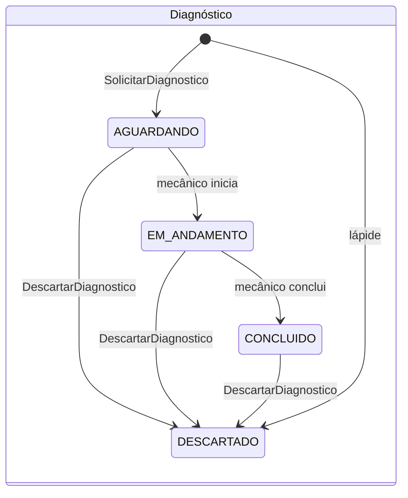

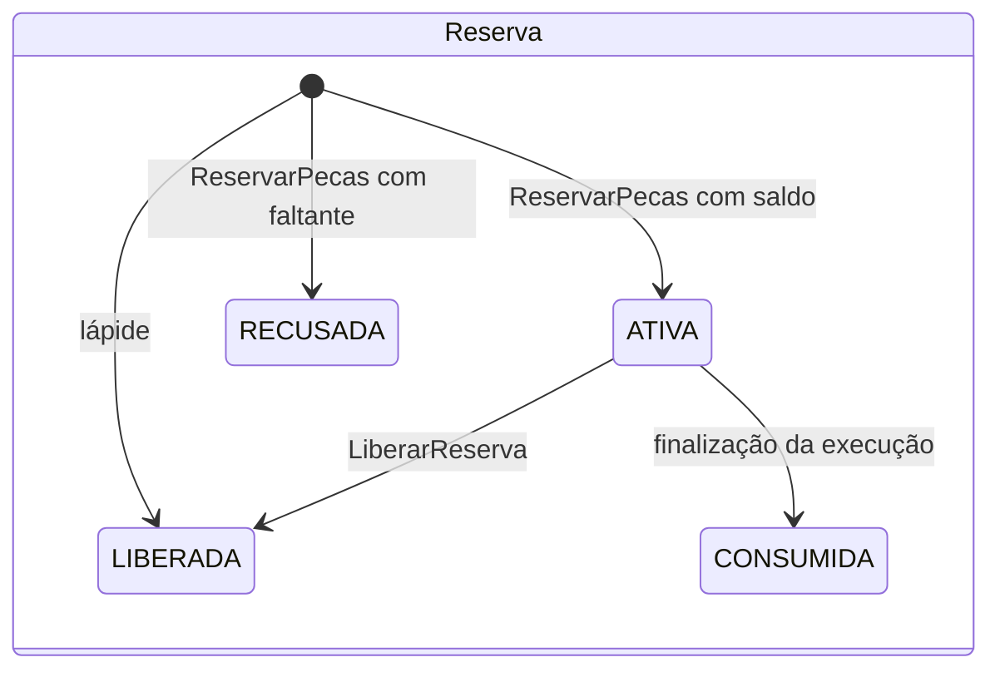

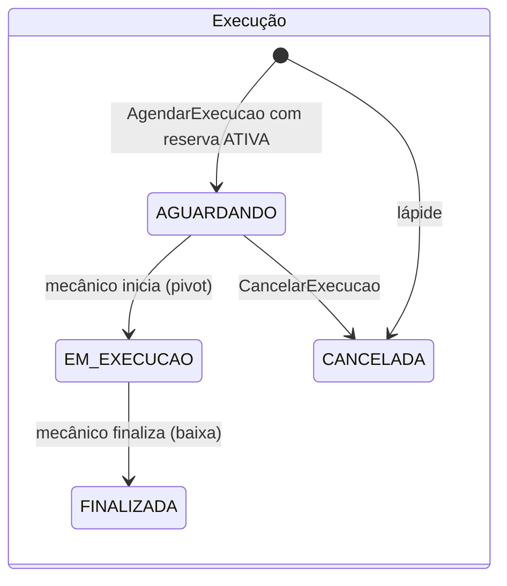

| Agregado | Estado final | O que acontece com o comando que chega depois |
|---|---|---|
| Diagnóstico | `DESCARTADO` | `DescartarDiagnostico` repetido reemite `DiagnosticoDescartado`; `SolicitarDiagnostico` atrasado, com o diagnóstico já `CONCLUIDO` ou `DESCARTADO`, é descartado com log |
| Reserva | `LIBERADA`, `CONSUMIDA`, `RECUSADA` | `ReservarPecas` repetido reemite a resposta enquanto a reserva está `ATIVA` ou `RECUSADA` e é descartado depois de `LIBERADA` ou `CONSUMIDA`; `LiberarReserva` repetido reemite `ReservaLiberada` e, com a reserva `CONSUMIDA`, é ignorado |
| Execução | `FINALIZADA`, `CANCELADA` | `CancelarExecucao` repetido reemite `ExecucaoCancelada` e, depois do início, é ignorado; `AgendarExecucao` repetido reemite a posição atual enquanto `AGUARDANDO` e é descartado depois |

## 4. Fluxos passo a passo

Em todos os fluxos, o evento do catálogo da saga é gravado na `outbox` na mesma transação do estado, e o relay o publica depois ([seção 4.6](#46-outbox-relay-e-consumidor)); os diagramas mostram a gravação, não a publicação. Os comandos chegam pelo consumidor, que comita uma vez só, com o efeito, as respostas na outbox e o `id` do comando juntos.

### 4.1 Diagnóstico

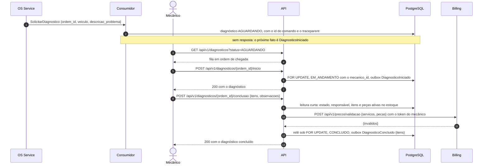

1. O `SolicitarDiagnostico` cria o diagnóstico em `AGUARDANDO`, com o retrato do veículo, a descrição do problema, o `id` do comando (`solicitacao_id`) e o contexto de trace. O comando repetido devolve o diagnóstico existente sem mudar nada; com o diagnóstico já concluído ou descartado (inclusive a lápide), o atrasado é descartado com o log `command_ignored` (`COMANDO_ATRASADO`).
2. O mecânico lista a fila (`AGUARDANDO`, mais antigo primeiro) e assume um diagnóstico: o `sub` do token vira o responsável, sob `SELECT ... FOR UPDATE`, e `DiagnosticoIniciado` vai para a outbox com o `causation_id` igual ao `solicitacao_id`. Repetir pelo mesmo mecânico devolve o estado atual sem novo evento; o admin pode assumir, com log de auditoria.
3. A conclusão tem três etapas, para nenhuma conexão do banco ficar presa enquanto o Billing responde ([`ConcluirDiagnostico`](../src/diagnostico/aplicacao/use_cases.py)): uma leitura curta confere o estado, o responsável, os itens (de 1 a 50, quantidade positiva) e as peças no estoque local (SKU cadastrado e ativo); a chamada ao Billing roda sem transação aberta, com timeout de 2 s, 2 retries com jitter só em erro transitório e circuit breaker (5 falhas abrem por 30 s); e uma escrita curta relê a linha sob lock e conclui, com `DiagnosticoConcluido {itens, observacoes}`.
4. Desfechos de erro: código sem preço ou peça sem cadastro ativo, 422 com os códigos recusados; Billing fora, 5xx, timeout depois dos retries ou circuito aberto, 503 (com `Retry-After` no circuito aberto); 4xx do Billing ou resposta fora do contrato, 502 `RESPOSTA_INVALIDA_DA_DEPENDENCIA`, sem retry. Só o mecânico que iniciou conclui; o admin conclui em nome dele, sem trocar o responsável.

### 4.2 Reserva de peças

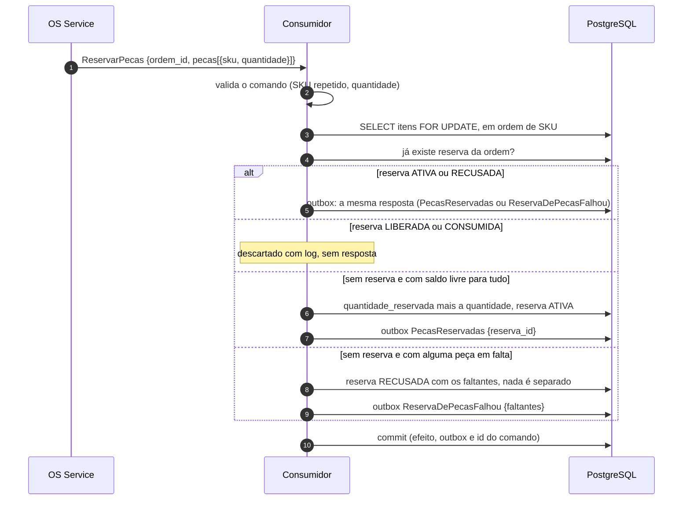

1. O comando é validado antes de travar linhas; o contrato já recusou SKU fora do formato do Billing (vai para a DLQ, a fila de mensagens mortas `execucao.comandos.dlq`, sem resposta, e a saga compensa pelo prazo técnico da etapa, [RFC-004, seção 4.6](https://github.com/fiap-postech-sw-architecture/postech-sw-arch-p4-platform/blob/main/docs/arquitetura/rfc/fase4/rfc-004-microsservicos-saga.md#46-prazos)).
2. Os itens são travados com `SELECT ... FOR UPDATE` sempre em ordem de SKU, o que evita deadlock entre reservas, e só então a reserva existente é conferida: a segunda cópia simultânea do mesmo comando espera a primeira e vê a decisão dela. Sem itens para travar (lista vazia), a `UNIQUE` de `ordem_id` barra a segunda cópia, que roda de novo e cai na regra de repetição (`releitura_em_corrida`, [`idempotencia.py`](../src/compartilhado/aplicacao/idempotencia.py)).
3. A regra é tudo ou nada ([`services.py`](../src/estoque/dominio/services.py)): SKU ausente ou inativo conta com saldo livre 0. Com tudo disponível, a reserva nasce `ATIVA` e soma em `quantidade_reservada`; com qualquer falta, nada é separado e a recusa fica registrada como `RECUSADA`, com `{sku, solicitado, disponivel}` de cada faltante, para o reenvio receber a mesma resposta (uma reposição do estoque no meio do caminho não vira reserva tardia).

### 4.3 Execução e fila

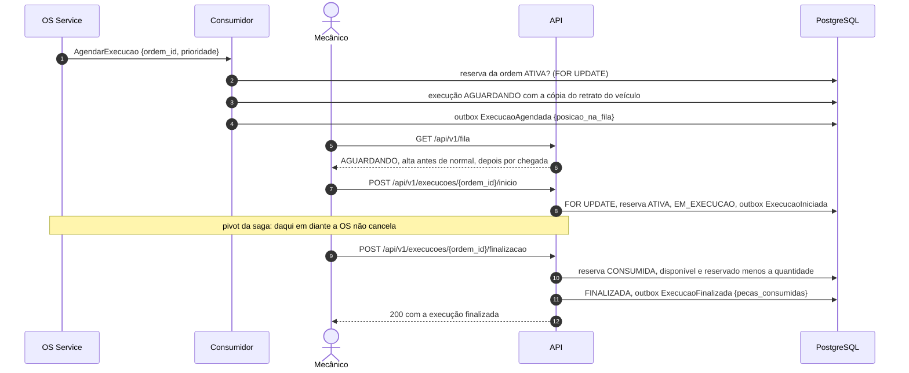

1. O `AgendarExecucao` só põe na fila a ordem com reserva `ATIVA` (RN-027): sem ela a execução nunca poderia ser finalizada. Sem a reserva, o caso de uso recusa o comando, e o consumidor o trata como fora do estado (ignorado com ack, sem resposta). A execução nova copia o retrato do veículo do diagnóstico e responde `ExecucaoAgendada` com a posição atual na fila; o reenvio com a execução ainda em `AGUARDANDO` reemite a posição atual, e o que chega depois do início, da finalização ou do cancelamento é descartado.
2. A fila (`GET /api/v1/fila`) mostra só `AGUARDANDO`: `alta` antes de `normal` e, dentro da mesma prioridade, por `enfileirada_em`, com a posição absoluta de cada ordem.
3. O início é o pivot da saga ([RFC-004, seção 4.4](https://github.com/fiap-postech-sw-architecture/postech-sw-arch-p4-platform/blob/main/docs/arquitetura/rfc/fase4/rfc-004-microsservicos-saga.md#44-pivot-e-plano-de-compensação)): exige a reserva ainda `ATIVA`, travada até o commit (409 sem ela), porque depois dele a OS não cancela. As guardas (transição, responsável, reserva) rodam antes de mudar o agregado.
4. A finalização dá baixa e finaliza na mesma transação local: a reserva vira `CONSUMIDA`, cada peça perde a quantidade no disponível e no reservado, e `ExecucaoFinalizada` leva as `pecas_consumidas`. A baixa vem antes de mexer no agregado, então reserva fora de `ATIVA` recusa a finalização sem mudar nada. Só o mecânico que iniciou finaliza; o admin finaliza em nome dele, com log de auditoria.

### 4.4 Compensações e lápide

O OS Service decide o plano e a ordem das compensações ([RFC-004, seção 4.4](https://github.com/fiap-postech-sw-architecture/postech-sw-arch-p4-platform/blob/main/docs/arquitetura/rfc/fase4/rfc-004-microsservicos-saga.md#44-pivot-e-plano-de-compensação)) e manda uma de cada vez, esperando a resposta; as três que chegam aqui são idempotentes por ordem.

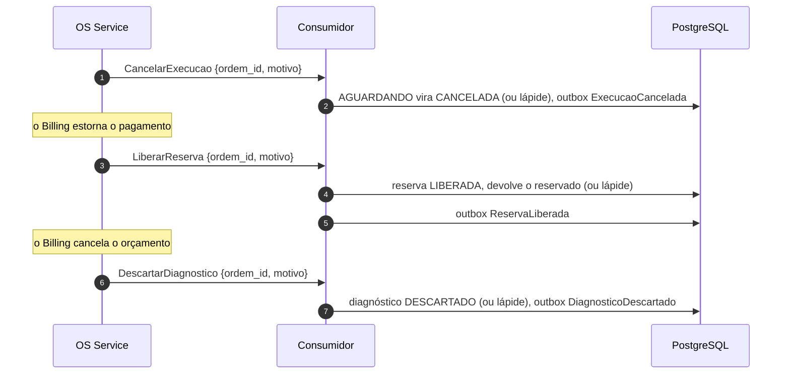

| Comando | Efeito | Repetido | Fora do estado |
|---|---|---|---|
| `CancelarExecucao` | `AGUARDANDO` vira `CANCELADA`, e a ordem sai da fila | reemite `ExecucaoCancelada` | depois do início (pivot), ignorado: o `ExecucaoIniciada` já publicado conta a história |
| `LiberarReserva` | `ATIVA` vira `LIBERADA` e devolve as quantidades reservadas; a recusada não tinha nada separado e só responde | reemite `ReservaLiberada`, sem devolver de novo | reserva `CONSUMIDA` (execução finalizada) não volta: ignorado |
| `DescartarDiagnostico` | qualquer estado não final vira `DESCARTADO` | reemite `DiagnosticoDescartado` | não há: o descarte vale até para o concluído |

**Lápide.** Quando a compensação chega antes do comando original (o passo ainda em voo, [RFC-004, seção 4.5](https://github.com/fiap-postech-sw-architecture/postech-sw-arch-p4-platform/blob/main/docs/arquitetura/rfc/fase4/rfc-004-microsservicos-saga.md#45-contramedidas-de-isolamento)), o caso de uso grava o agregado já no estado final (reserva `LIBERADA` sem peças, execução `CANCELADA`, diagnóstico `DESCARTADO` sem retrato) e responde. O original, quando chegar, encontra a lápide pela chave `ordem_id` e é descartado. O `motivo` das compensações não é usado aqui: o histórico da saga fica no OS Service, e o texto livre nunca vai para log.

### 4.5 Anonimização LGPD

O OS Service, dono do cadastro, elimina os dados do titular e manda `AnonimizarVeiculo {veiculo_id}` para apagar as cópias daqui; o comando fica fora da saga e não tem resposta ([`AnonimizarVeiculo`](../src/execucao/aplicacao/use_cases.py)).

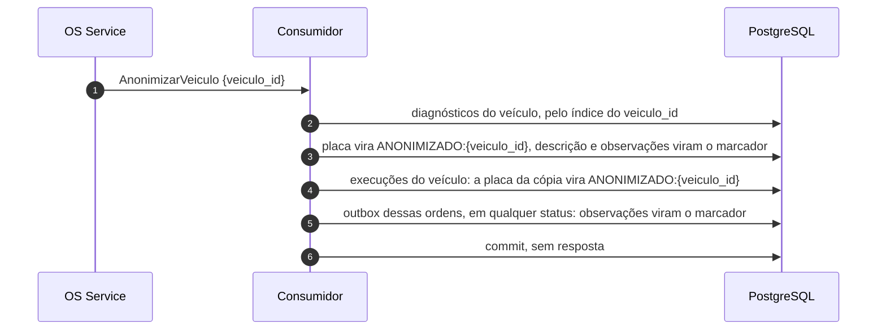

1. Os retratos são achados pelo índice em `veiculo ->> 'veiculo_id'`, nas duas tabelas.
2. A placa vira `ANONIMIZADO:{veiculo_id}` no diagnóstico e na cópia da execução; a descrição do problema e as observações, texto livre que pode trazer nome, endereço ou a própria placa, viram `[removido na eliminacao de dados pessoais]` ([`veiculo.py`](../src/compartilhado/dominio/veiculo.py)), inclusive nas observações das mensagens que ainda estão na outbox. Marca, modelo e ano ficam: não identificam o titular.
3. Repetido, nada muda e o comando é descartado. O OS Service só elimina cliente sem OS ativa; registro ainda em andamento é anonimizado do mesmo jeito, com aviso no log (`vehicle_anonymized_while_in_progress`).

### 4.6 Outbox, relay e consumidor

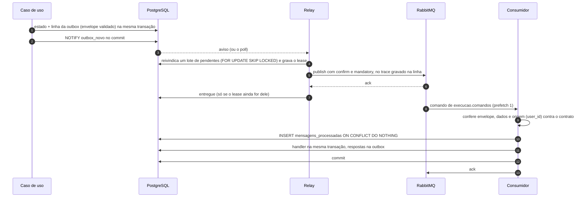

- **Gravação.** O caso de uso registra o evento na unidade de trabalho, que grava a linha da outbox no commit, já como o envelope do contrato, validado contra o JSON Schema (falha aqui é defeito do serviço), com o destino e o contexto de trace de quem gravou ([`unit_of_work.py`](../src/compartilhado/infraestrutura/unit_of_work.py)).
- **Relay** ([`relay.py`](../src/compartilhado/infraestrutura/mensageria/relay.py), [`outbox.py`](../src/compartilhado/infraestrutura/mensageria/outbox.py)): acorda pelo `NOTIFY` ou pelo poll; reivindica em transação curta e publica sem transação aberta; não passa à frente de mensagem pendente da mesma ordem (`ix_outbox_correlacao`). Sem rota, nack ou recusa do broker contam tentativa, com atraso crescente, e a quinta falha vira `dead`; queda do broker não conta tentativa. A limpeza periódica apaga, em lotes, as entregues e as `dead` vencidas. O tamanho do lote, o lease, o poll, os atrasos e os prazos da limpeza estão no README, em [Mensageria](../README.md#mensageria).
- **Consumidor** ([`consumidor.py`](../src/compartilhado/infraestrutura/mensageria/consumidor.py)): o `id` entra em `mensagens_processadas` antes do handler, a sessão do handler fica presa à transação da mensagem por savepoint e só o consumidor comita. `id` repetido recebe ack sem efeito; comando fora do estado é ignorado com ack (o `id` fica gravado); erro transitório vai para a fila de retry da tentativa; erro permanente, não classificado ou a quinta falha vão para a DLQ.

## 5. Mensageria

Topologia, envelope, catálogo e garantias estão na [RFC-004, seções 4 e 5](https://github.com/fiap-postech-sw-architecture/postech-sw-arch-p4-platform/blob/main/docs/arquitetura/rfc/fase4/rfc-004-microsservicos-saga.md#5-mensageria), no [ADR-036](https://github.com/fiap-postech-sw-architecture/postech-sw-arch-p4-platform/blob/main/docs/arquitetura/adr/fase4/036-mensageria-rabbitmq.md) e no [README do `platform`](https://github.com/fiap-postech-sw-architecture/postech-sw-arch-p4-platform#readme); os contratos que este serviço consome e produz são a cópia em [`contratos/`](../contratos), presa ao commit de [`contratos/ORIGEM`](../contratos/ORIGEM). O que é deste serviço:

| Sentido | Onde | Mensagens |
|---|---|---|
| Consome | fila `execucao.comandos` (exchange `pytstop.comandos`, binding `comando.execucao.#`) | `SolicitarDiagnostico`, `DescartarDiagnostico`, `ReservarPecas`, `LiberarReserva`, `AgendarExecucao`, `CancelarExecucao`, `AnonimizarVeiculo` |
| Publica | exchange `pytstop.eventos`, routing key `evento.execucao.<tipo em snake_case>` | `DiagnosticoIniciado`, `DiagnosticoConcluido`, `DiagnosticoDescartado`, `PecasReservadas`, `ReservaDePecasFalhou`, `ReservaLiberada`, `ExecucaoAgendada`, `ExecucaoCancelada`, `ExecucaoIniciada`, `ExecucaoFinalizada` |
| Retry | `execucao.comandos.retry.1s`, `.5s`, `.15s`, `.60s` e `.300s` (exchange `pytstop.retry`), cujo TTL devolve a cópia à fila de trabalho | cópia do comando com `x-tentativa` incrementado |
| DLQ | `execucao.comandos.dlq` (exchange `pytstop.dlx`) | erro permanente, não classificado, quinta falha ou `delivery-limit` 5 da fila |

O `causation_id` é como o orquestrador casa cada evento: a resposta a um comando leva o `id` dele, e o fato que o mecânico gera pela API leva o `id` do comando que abriu o fluxo (`solicitacao_id` e `agendamento_id`). Os detalhes de entrega (lease, fencing, `Connection.Blocked`, entrada hostil, prontidão) estão no README, em [Mensageria](../README.md#mensageria).

## 6. Segurança e LGPD

- **Autenticação e papéis** ([ADR-039](https://github.com/fiap-postech-sw-architecture/postech-sw-arch-p4-platform/blob/main/docs/arquitetura/adr/fase4/039-autenticacao-entre-servicos.md)): JWT RS256 emitido pelo OS Service e validado localmente pelo JWKS, com `iss`, `aud`, `exp`, `sub` e `type=access` conferidos ([`jwks.py`](../src/compartilhado/infraestrutura/jwks.py), [`autenticacao.py`](../src/compartilhado/interfaces/autenticacao.py)). Toda falha de credencial responde o mesmo 401; papel válido sem permissão, 403. Mecânico e admin agem no diagnóstico e na execução; atendente lê a fila e o estoque; só o admin escreve no estoque. A matriz por rota está no README, em [API](../README.md#api).
- **Responsável e auditoria**: só o mecânico que iniciou conclui ou finaliza; o admin age em nome dele sem trocar o responsável, e toda ação do admin (inclusive as escritas no estoque) gera o log `audit` com ação, ator e alvo, só com identificadores ([`responsavel.py`](../src/compartilhado/aplicacao/responsavel.py)).
- **Dado pessoal guardado**: o retrato do veículo (placa, marca, modelo, ano e o `veiculo_id`), a descrição do problema e as observações. Nada de nome, documento ou contato do cliente, que ficam no OS Service. A eliminação segue a [seção 4.5](#45-anonimização-lgpd).
- **Fora dos logs, spans e métricas**: o pipeline de log mascara chaves sensíveis (senha, token, placa, observações, `motivo` e outras) e os padrões de CPF, CNPJ, e-mail, telefone e placa ([`logging.py`](../src/compartilhado/infraestrutura/logging.py)); os spans saem sem o caminho cru, a query, o texto de erro e os dados de rede do chamador; os rótulos das métricas são só códigos do catálogo. O detalhe está no README, em [O que não é exportado](../README.md#o-que-não-é-exportado-e-por-quê).
- **Retenção**: `mensagens_processadas` por 30 dias; na outbox, a entregue por 7 dias, contados da confirmação do broker (`entregue_em`), e a `dead` por 30, contados do fim do último lease (`proxima_tentativa_em`), não da gravação ([`outbox.py`](../src/compartilhado/infraestrutura/mensageria/outbox.py)).
- **Banco e cluster**: papéis separados no PostgreSQL (o dono `execucao` só no Job de migração; `execucao_app`, só DML, na API, no relay e no consumidor; `execucao_exporter`, `pg_monitor`), sem conexão sem senha nem no loopback, NetworkPolicy com entrada negada por padrão, Pod Security `restricted` e nenhum Secret no repositório ([`k8s/base/papeis.sql`](../k8s/base/papeis.sql) e README, [Implantação](../README.md#implantação)).

## 7. Observabilidade

Métricas no `/metrics` de cada processo (fora da borda: o Kong responde 404 e o Prometheus raspa o pod), traces OTLP para o Jaeger com o contexto W3C seguindo pela outbox e pelos headers AMQP, e logs JSON com `trace_id`, `span_id` e `correlation_id` ([ADR-043](https://github.com/fiap-postech-sw-architecture/postech-sw-arch-p4-platform/blob/main/docs/arquitetura/adr/fase4/043-observabilidade-distribuida.md)). As séries, os spans e o que fica de fora estão no README, em [Observabilidade](../README.md#observabilidade); os dashboards, os alertas e o catálogo de métricas dos três serviços estão no [`observabilidade/README.md`](https://github.com/fiap-postech-sw-architecture/postech-sw-arch-p4-platform/blob/main/observabilidade/README.md#catálogo-de-métricas) do `platform`.

## 8. Decisões

| Decisão | Onde está |
|---|---|
| Serviço próprio para diagnóstico, execução e estoque físico; a peça existe aqui (quantidade) e no Billing (preço), ligada pelo SKU | [ADR-034](https://github.com/fiap-postech-sw-architecture/postech-sw-arch-p4-platform/blob/main/docs/arquitetura/adr/fase4/034-decomposicao-em-microsservicos.md) |
| Participante da saga orquestrada, com o pivot no início da execução | [ADR-035](https://github.com/fiap-postech-sw-architecture/postech-sw-arch-p4-platform/blob/main/docs/arquitetura/adr/fase4/035-saga-orquestrada.md) |
| RabbitMQ, outbox transacional, consumidor idempotente, retry com atraso e DLQ | [ADR-036](https://github.com/fiap-postech-sw-architecture/postech-sw-arch-p4-platform/blob/main/docs/arquitetura/adr/fase4/036-mensageria-rabbitmq.md) |
| PostgreSQL próprio, sem acesso de outro serviço | [ADR-037](https://github.com/fiap-postech-sw-architecture/postech-sw-arch-p4-platform/blob/main/docs/arquitetura/adr/fase4/037-banco-por-servico.md) |
| Única chamada síncrona (Billing), com timeout, retry e circuit breaker; borda no Kong | [ADR-038](https://github.com/fiap-postech-sw-architecture/postech-sw-arch-p4-platform/blob/main/docs/arquitetura/adr/fase4/038-borda-e-comunicacao-sincrona.md) |
| JWT validado localmente pelo JWKS, papel por rota | [ADR-039](https://github.com/fiap-postech-sw-architecture/postech-sw-arch-p4-platform/blob/main/docs/arquitetura/adr/fase4/039-autenticacao-entre-servicos.md) |
| Cobertura de 95% no total e 90% no código novo, mutação nos módulos críticos | [ADR-041](https://github.com/fiap-postech-sw-architecture/postech-sw-arch-p4-platform/blob/main/docs/arquitetura/adr/fase4/041-estrategia-de-testes-e-qualidade.md) |
| CI por serviço e deploy no Kubernetes, com migração que expande e contrai | [ADR-042](https://github.com/fiap-postech-sw-architecture/postech-sw-arch-p4-platform/blob/main/docs/arquitetura/adr/fase4/042-cicd-e-deploy-kubernetes.md) |
| Traces, métricas e logs correlacionados pela ordem | [ADR-043](https://github.com/fiap-postech-sw-architecture/postech-sw-arch-p4-platform/blob/main/docs/arquitetura/adr/fase4/043-observabilidade-distribuida.md) |
| A reserva não consome o saldo: move para o reservado, e a baixa é na finalização | [`estoque/dominio/services.py`](../src/estoque/dominio/services.py) |
| A recusa da reserva fica gravada (`RECUSADA`), para o reenvio receber a mesma resposta | [`estoque/aplicacao/use_cases.py`](../src/estoque/aplicacao/use_cases.py) (`ReservarPecas`) |
| Lápide por `ordem_id` para a compensação que chega antes do comando | `DescartarDiagnostico`, `LiberarReserva` e `CancelarExecucao` nos casos de uso de cada contexto |
| Contexto de trace e `id` do comando guardados com o diagnóstico e a execução, fora do agregado | [`rastreamento.py`](../src/compartilhado/infraestrutura/rastreamento.py), [`002_mensageria.py`](../migrations/versions/002_mensageria.py) |
| Conclusão do diagnóstico sem transação aberta durante a chamada ao Billing | [`diagnostico/aplicacao/use_cases.py`](../src/diagnostico/aplicacao/use_cases.py) (`ConcluirDiagnostico`) |
| Transação da mensagem comitada só pelo consumidor, com a sessão do handler presa por savepoint | [`unit_of_work.py`](../src/compartilhado/infraestrutura/unit_of_work.py) (`TransacaoDaMensagem`), [`consumidor.py`](../src/compartilhado/infraestrutura/mensageria/consumidor.py) |
| Claim do relay com lease e fencing, sem transação aberta durante a publicação | [`mensageria/outbox.py`](../src/compartilhado/infraestrutura/mensageria/outbox.py) |
| Gauges de negócio por conexão crua do driver, com prazo total de 5 s por raspagem | [`coletor.py`](../src/coletor.py) |
| Cópia própria do JWKS (fresca por 10 min, a última boa vale até 1 h com o OS fora), no lugar do cache do `PyJWKClient` que o ADR-039 descreve | [`jwks.py`](../src/compartilhado/infraestrutura/jwks.py) |
| Na eliminação LGPD, a placa e os textos livres do veículo saem dos diagnósticos, das execuções e das mensagens ainda guardadas na outbox | [RFC-004, seção 5.3](https://github.com/fiap-postech-sw-architecture/postech-sw-arch-p4-platform/blob/main/docs/arquitetura/rfc/fase4/rfc-004-microsservicos-saga.md#53-catálogo-de-comandos-e-eventos), [ADR-037](https://github.com/fiap-postech-sw-architecture/postech-sw-arch-p4-platform/blob/main/docs/arquitetura/adr/fase4/037-banco-por-servico.md) e [`execucao/aplicacao/use_cases.py`](../src/execucao/aplicacao/use_cases.py) (`AnonimizarVeiculo`) |
